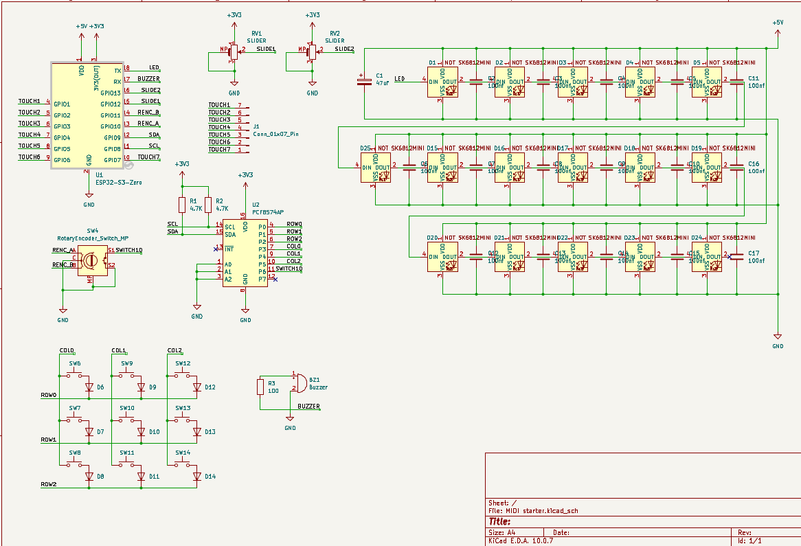
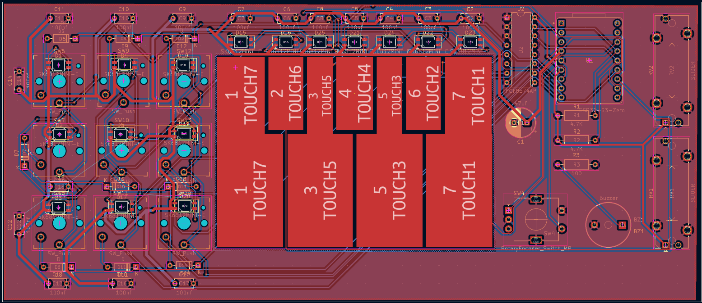

# Custom ESP32-S3 MIDI Controller & Chiptune Pad

## What the Project Is
This project is a custom-designed, all-in-one USB MIDI controller and standalone chiptune synthesizer built around the **Waveshare ESP32-S3-Zero**. Designed in KiCad, the board combines a 7-key capacitive touch piano layout, a 3x3 mechanical macro pad with per-key RGB lighting, dual analog slide potentiometers, a clickable rotary encoder, and an onboard passive piezo buzzer into a compact desktop instrument. Whether plugged into a Digital Audio Workstation (DAW) over USB-C to control virtual instruments or used standalone to play 8-bit melodies through its buzzer, it gives hands-on tactile control for music production and live performance.

## How It Works
- **Capacitive Touch Piano Keys (`TOUCH1`–`TOUCH7`):** Seven custom PCB copper pads are routed directly to the ESP32-S3's hardware capacitive touch sensing pins (`GPIO1`–`GPIO7`), allowing expressive, zero-force note triggering.
- **I2C 3x3 Mechanical Switch Matrix (`PCF8574AP`):** To maximize GPIO efficiency, a `PCF8574AP` I2C I/O expander (`SDA` on `GPIO9`, `SCL` on `GPIO8`) scans a 3x3 diode-isolated mechanical switch matrix (`SW6`–`SW14` with `1N4148` diodes `D6`–`D14` for full N-key rollover) and reads the rotary encoder's pushbutton (`SW4` on `P6`).
- **Analog & Rotary Controls:** Two linear slide potentiometers (`RV1` and `RV2`) feed smooth analog control voltages into the ESP32-S3's internal ADCs (`GPIO12` and `GPIO13`) for MIDI CC fader mapping, while a quadrature rotary encoder on `GPIO10` and `GPIO11` handles menu navigation, BPM, or parameter scrubbing.
- **Addressable RGB Lighting & Audio Output:** Sixteen reverse-mount `SK6812MINI-E` addressable RGB LEDs are daisy-chained from `TX` (`GPIO43`) to illuminate the mechanical keys and touch pads, while a passive piezo buzzer (`BZ1`) on `RX` (`GPIO44`) uses hardware PWM (`LEDC`) to generate standalone chiptune tones and audio feedback.

## Project Photos

*Complete circuit schematic designed in KiCad 10, showing the ESP32-S3-Zero, PCF8574AP I2C expander, 3x3 diode matrix, and 16-LED SK6812MINI-E chain.*

*Custom 2-layer PCB layout featuring the 3x3 mechanical switch grid with reverse-mount RGB LEDs and the 7 custom-shaped capacitive touch piano keys.*

## Bill of Materials (Key Components)
- **Microcontroller:** 1x Waveshare ESP32-S3-Zero
- **I/O Expander:** 1x `PCF8574AP` (DIP-16) + 2x $4.7\text{ k}\Omega$ I2C pull-up resistors (`R1`, `R2`)
- **Mechanical Switches & Matrix Diodes:** 9x Cherry MX-compatible switches (`SW6`–`SW14`) + 9x `1N4148` DO-35 diodes (`D6`–`D14`)
- **Analog & Encoder Controls:** 2x Slide Potentiometers (`RV1`, `RV2`) + 1x Rotary Encoder with Pushbutton (`SW4`)
- **LEDs & Decoupling:** 16x `SK6812MINI-E` reverse-mount RGB LEDs, 16x $100\text{ nF}$ decoupling capacitors (`C2`–`C17`), 1x $47\text{ }\mu\text{F}$ bulk capacitor (`C1`)
- **Audio:** 1x Passive Piezo Buzzer (`BZ1`) + 1x $100\text{ }\Omega$ current-limiting resistor (`R3`)